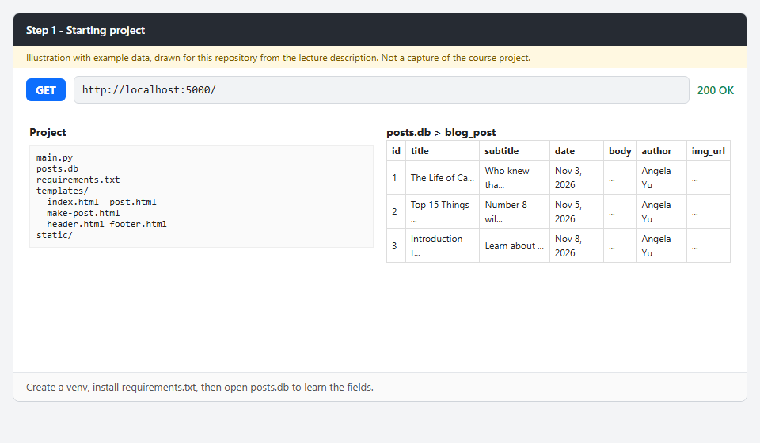
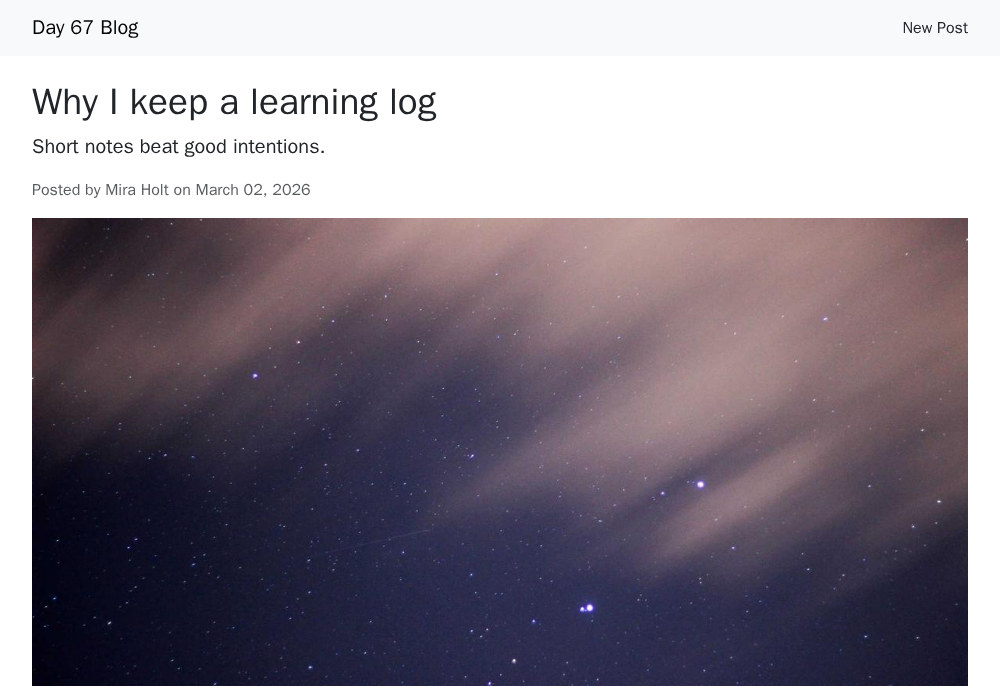
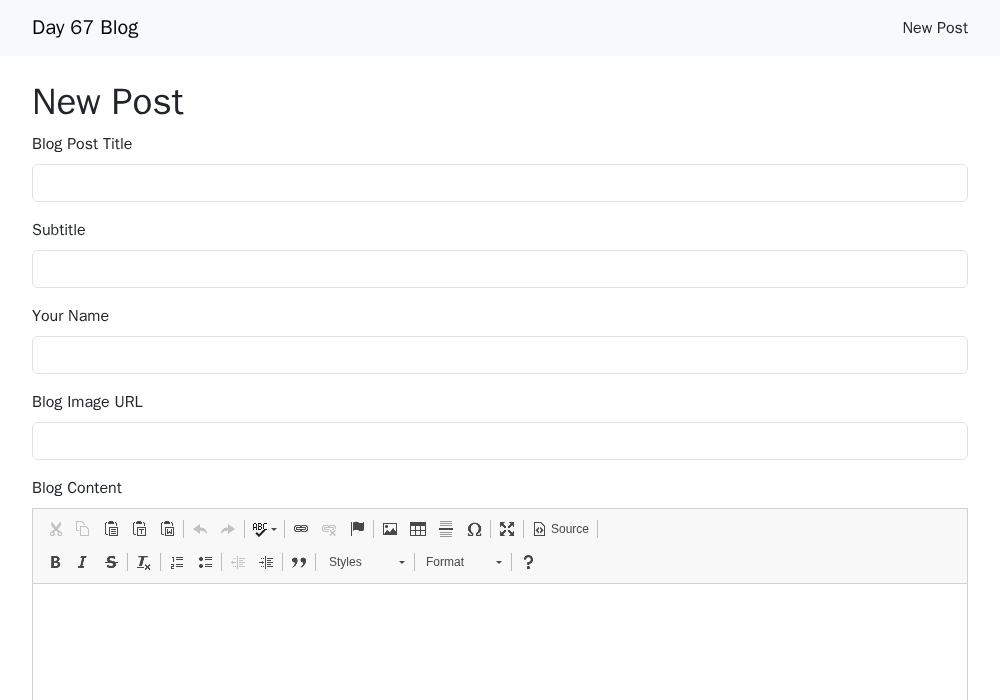
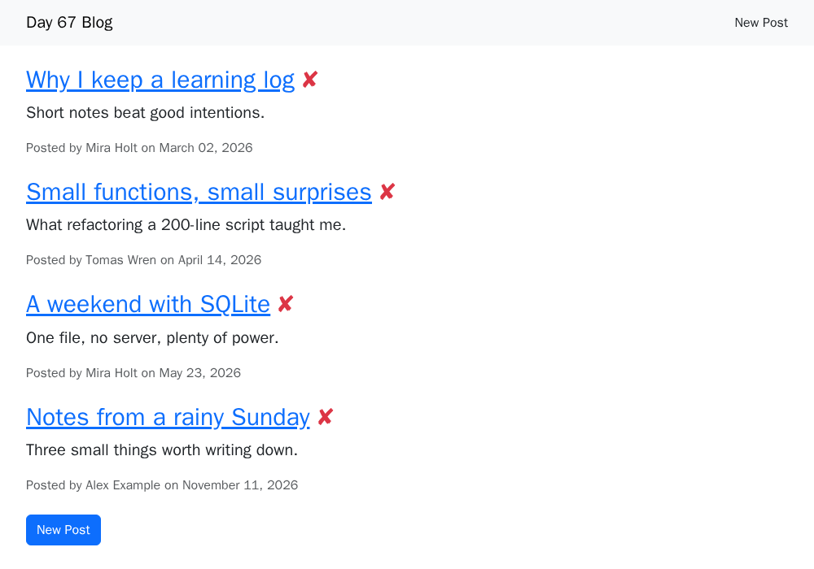
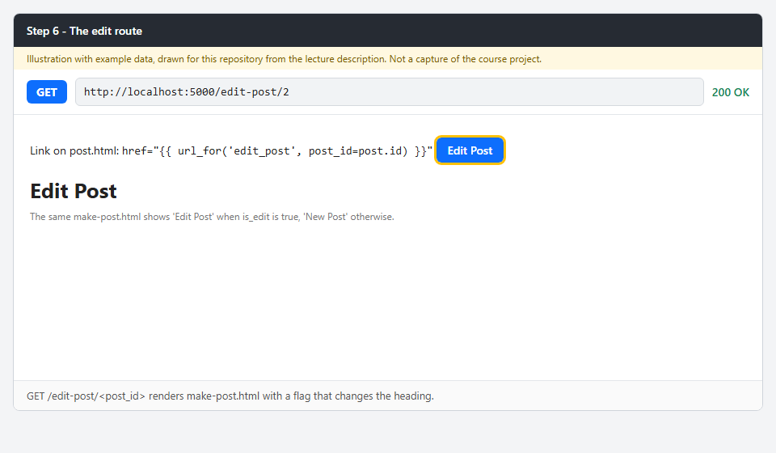
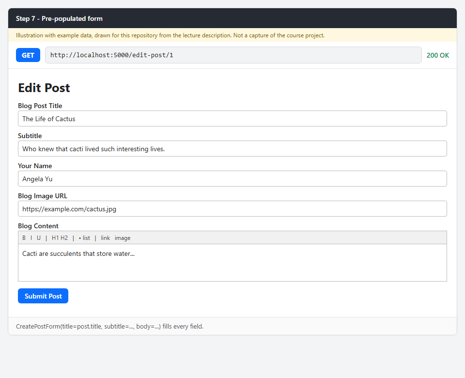
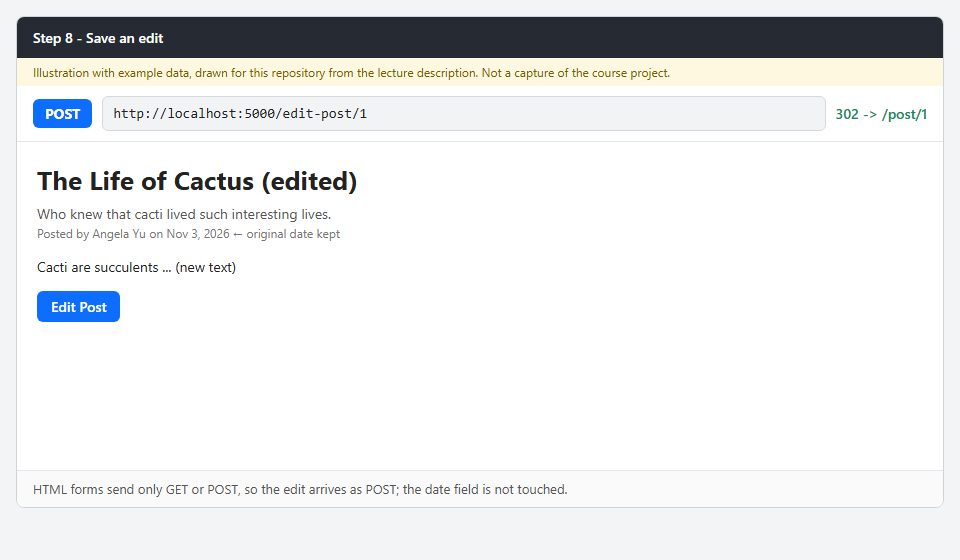
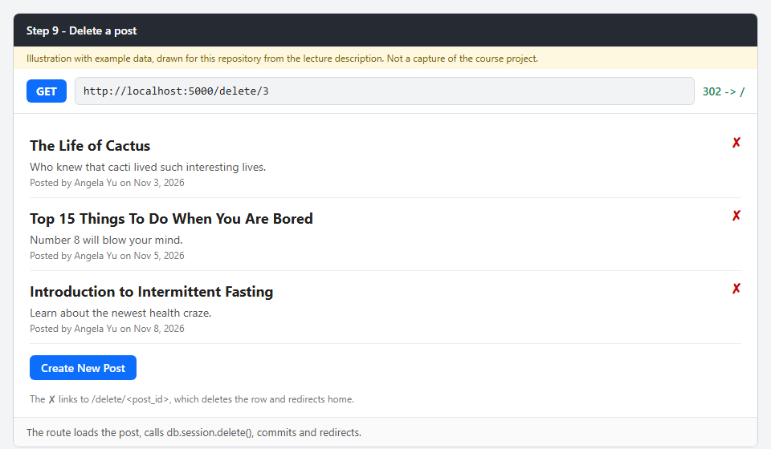

<!-- README of the Day 67 repository, from framework/templates/README-template.md. -->

# 🚀 067-blog-capstone-part-3

Notes and screenshots for Day 67 of Udemy's "100 Days of Code: The Complete Python Pro Bootcamp": building a RESTful blog with editing in Flask. For fellow course participants and anyone browsing for ideas.

## 📚 Table of Contents

- [Overview](#-overview)
- [Lecture steps](#-lecture-steps)
- [Requirements](#-requirements)
- [Setup](#-setup)
- [Run](#-run)
- [Tests](#-tests)
- [License](#-license)
- [Links](#-links)
- [Appendix: Project documents](#-appendix-project-documents)

## 🧭 Overview

The Day 67 lecture takes the blog further: the posts come from a SQLite database (`posts.db`) through Flask-SQLAlchemy, and you can read, create, edit and delete posts inside the website, with WTForms and a CKEditor field for the post body.

This repository documents what the lecture teaches. It holds **no application code**; the code belongs to the course. The lecture steps with screenshots are below, and the wiki explains what each step teaches, in English, Danish and Bahasa Malaysia.

| Part | Purpose |
| --- | --- |
| `docs/` | Project documents, the wiki source (`docs/wiki/`) and screenshots |
| `src/` | Reserved for source code (empty) |
| `tests/` | Reserved for `pytest` tests (empty) |
| `framework/` | The SQA and QC framework the project follows |

## 🎓 Lecture steps

The images are illustrations with example data, drawn for this repository from the lecture description; they are not captures of the course project. Each step has a wiki page that explains what we gained ([English][wiki-home], [Dansk][wiki-home-da], [Bahasa Malaysia][wiki-home-ms]).

### 1. The starting project

Set up the virtual environment, look at `main.py` and the `posts.db` database. [Read more][wiki-1]



### 2. All posts from the database

The `/` route reads every `BlogPost` with Flask-SQLAlchemy. [Read more][wiki-2]


### 3. One post by its id

`/post/<post_id>` loads one post and renders `post.html`. [Read more][wiki-3]



### 4. The new-post form

`/new-post` shows a WTForm with a CKEditor body field. [Read more][wiki-4]



### 5. Save a new post

A valid POST saves the post with a server-set date and redirects home. [Read more][wiki-5]



### 6. The edit route

`/edit-post/<post_id>` reuses `make-post.html` with the heading "Edit Post". [Read more][wiki-6]



### 7. Pre-populated form

The form is created with the post's values, so nothing is retyped. [Read more][wiki-7]



### 8. Save an edit

The edit arrives as POST, keeps the original date and redirects to the post. [Read more][wiki-8]



### 9. Delete a post

A ✘ link calls `/delete/<post_id>`, which deletes the post and redirects home. [Read more][wiki-9]



## 📋 Requirements

- Python 3.13 or newer (`python --version`), needed for the virtual environment and `pytest`.
- `git`, to clone the repository.
- Optional: [Doxygen][doxygen], to build the source documentation from the `Doxyfile`.

There are no runtime dependencies.

## 🛠️ Setup

Create and use a local virtual environment named `.venv` in the repository root, then upgrade `pip`.

Windows (PowerShell):

```powershell
python -m venv .venv
.\.venv\Scripts\Activate.ps1
python -m pip install --upgrade pip
python -m pip install pytest
```

macOS and Linux:

```bash
python3 -m venv .venv
source .venv/bin/activate
python -m pip install --upgrade pip
python -m pip install pytest
```

Leave the environment with `deactivate`. The `.venv` folder is ignored by git.

## ▶️ Run

There is nothing to run: the repository documents the lecture. Read the [wiki][wiki] or the lecture steps in this README. To build the (currently empty) source documentation:

```bash
doxygen Doxyfile
```

## 🧪 Tests

With the environment active:

```bash
python -m pytest
```

There is no code yet, so pytest reports "no tests ran" (exit code 5).

## 📄 License

See [LICENSE](./LICENSE).

## 🔗 Links

- [Repository][repository]
- [Documentation][wiki]
- [Issue tracker][issues]

## 📎 Appendix: Project documents

| Document | What it tells you |
| --- | --- |
| [AGENTS.md][agents] | The rules AI agents follow in this repository |
| [Business Case][BC-001] | Why the project exists, its scope and success criteria |
| [Stakeholder Analysis][SA-001] | Who is involved; the stakeholder IDs used for owners and reviewers |
| [Project Plan][PP-001] | The gateways and their schedule |
| [Milestones][milestones] | One document per gateway: Go/No-Go criteria and tasks |
| [Artifact registry][registry] | Where each artifact type lives, the next version, the PO language and domain |
| [Framework README][framework-readme] | The framework this project uses |
| [Framework changelog][framework-changelog] | What changed in each framework release |

---

[repository]: https://git.tirsystem.com/Tirsvad-Udemy-100-days-of-code/067-blog-capstone-part-3
[wiki]: https://git.tirsystem.com/Tirsvad-Udemy-100-days-of-code/067-blog-capstone-part-3/wiki
[issues]: https://git.tirsystem.com/Tirsvad-Udemy-100-days-of-code/067-blog-capstone-part-3/issues
[doxygen]: https://www.doxygen.nl/
[wiki-home]: https://git.tirsystem.com/Tirsvad-Udemy-100-days-of-code/067-blog-capstone-part-3/wiki/Home
[wiki-home-da]: https://git.tirsystem.com/Tirsvad-Udemy-100-days-of-code/067-blog-capstone-part-3/wiki/Home-da
[wiki-home-ms]: https://git.tirsystem.com/Tirsvad-Udemy-100-days-of-code/067-blog-capstone-part-3/wiki/Home-ms
[wiki-1]: https://git.tirsystem.com/Tirsvad-Udemy-100-days-of-code/067-blog-capstone-part-3/wiki/Step-1-Starting-Project
[wiki-2]: https://git.tirsystem.com/Tirsvad-Udemy-100-days-of-code/067-blog-capstone-part-3/wiki/Step-2-All-Posts
[wiki-3]: https://git.tirsystem.com/Tirsvad-Udemy-100-days-of-code/067-blog-capstone-part-3/wiki/Step-3-One-Post
[wiki-4]: https://git.tirsystem.com/Tirsvad-Udemy-100-days-of-code/067-blog-capstone-part-3/wiki/Step-4-New-Post-Form
[wiki-5]: https://git.tirsystem.com/Tirsvad-Udemy-100-days-of-code/067-blog-capstone-part-3/wiki/Step-5-Save-New-Post
[wiki-6]: https://git.tirsystem.com/Tirsvad-Udemy-100-days-of-code/067-blog-capstone-part-3/wiki/Step-6-Edit-Route
[wiki-7]: https://git.tirsystem.com/Tirsvad-Udemy-100-days-of-code/067-blog-capstone-part-3/wiki/Step-7-Prefill-Form
[wiki-8]: https://git.tirsystem.com/Tirsvad-Udemy-100-days-of-code/067-blog-capstone-part-3/wiki/Step-8-Save-Edit
[wiki-9]: https://git.tirsystem.com/Tirsvad-Udemy-100-days-of-code/067-blog-capstone-part-3/wiki/Step-9-Delete-Post
[agents]: ./AGENTS.md
[BC-001]: ./docs/business-case.md
[SA-001]: ./docs/stakeholder-analysis.md
[PP-001]: ./docs/project-plan.md
[milestones]: ./docs/milestones/
[registry]: ./docs/artifact-registry.md
[framework-readme]: ./framework/README.md
[framework-changelog]: ./framework/CHANGELOG.md
