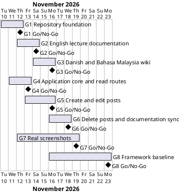

# Project Plan

## Metadata
| Key | Value |
| --- | --- |
| ID | PP-001 |
| CrossReference | [BC-001], [SA-001], [MIL-001], [MIL-002], [MIL-003], [MIL-004], [MIL-005], [MIL-006], [MIL-007], [US-001], [MIL-008] |
| Language | en |
| Domain | education |

## Version History
| Date | Status | Author | Reviewer | Change | Commit |
| --- | --- | --- | --- | --- | --- |
| 2026-11-11 | Deprecated | Jens Tirsvad Nielsen | S01 | Added gateways G4 to G6 for the blog application; end date moved to 2026-11-18; Go on RC-011, supervised | [bb4ab74] |
| 2026-11-11 | Deprecated | Jens Tirsvad Nielsen | S01 | Added gateway G7 (real screenshots); end date moved to 2026-11-19; stale open issues removed; Go on RC-021, supervised | [0d98508] |
| 2026-11-16 | Accepted | Jens Tirsvad Nielsen | AI as stand-in for S01 | Added the baseline gateway MIL-008 (G8) with its schedule row, scope coverage, dependency, risk and Gantt entries; recorded the move of the end date, the domain, the open pull request #58, the prompt log, the new traceability matrix and the CI in the Planning Assumptions and Open Issues; replaced `not yet synced` in the milestone column of the seven earlier gateways with the links to their milestones on the git host; marked the points about the illustrations as historical; set the domain to education; reviewed in autonomous mode, not independent | pending |

---

## Purpose

This plan schedules eight gateways: G1 to G3 delivered the Day 67 README and trilingual wiki; G4 to G6 build the blog application and bring the documentation in line with it; G7 replaces the illustrations with screenshots captured from the running app; G8 ([MIL-008]) brings the finished project to the baseline of the framework. The project runs from 2026-11-10 to 2026-11-23 ([BC-001]); G8 moves the end date from 2026-11-19 to 2026-11-23.

## Planning Assumptions

- The project started 2026-11-10 and was to end by 2026-11-19, per the revised Business Case constraint; since G8 it ends by 2026-11-23. G4 to G6 were delivered on 2026-11-11, ahead of their decision dates.
- Each gateway is one branch and one pull request. Gateway length is two to three days.
- S01 owns and approves every gateway, as in [SA-001]; the AI acts as stand-in in autonomous mode.
- The baseline gateway G8 (MIL-008) starts 2026-11-16 and ends 2026-11-23, one week (source: [BC-001], Constraints). It brings the finished project to the baseline of the framework, a decision of S01. The decision dates of the seven earlier gateways stay as they were, so the end date of the plan moves from 2026-11-19 to 2026-11-23.
- For MIL-008 S01 has authorised the assistant to commit, push, open the pull request and merge it, and the review is done by an AI stand-in for S01 (source: [BC-001], Constraints and Risks).
- The PO language is English; the domain is IT until [MIL-008] and education since.
- Screenshots were illustrations with example data until G7 (merged) replaced them with captures of the running app. The captures are taken in a Docker container with a headless browser, as `framework/process/gui-testing.md` requires.

## Gateway Schedule

| Gateway | Document | Window | Decision date | Owner | Stories | Main deliverable | Milestone |
| --- | --- | --- | --- | --- | --- | --- | --- |
| G1 Repository foundation | [MIL-001] | 2026-11-10 to 2026-11-12 | 2026-11-12 | S01 | none (technical tasks) | Repository metadata, project configuration, README skeleton, scan | [Milestone 418][ms-418] |
| G2 English lecture documentation | [MIL-002] | 2026-11-12 to 2026-11-14 | 2026-11-14 | S01 | none (documentation tasks) | English wiki, README steps, screenshots | [Milestone 419][ms-419] |
| G3 Danish and Bahasa Malaysia wiki | [MIL-003] | 2026-11-14 to 2026-11-16 | 2026-11-16 | S01 | none (documentation tasks) | Danish and Bahasa Malaysia wiki, language links | [Milestone 420][ms-420] |
| G4 Application core and read routes | [MIL-004] | 2026-11-11 to 2026-11-13 | 2026-11-13 | S01 | US-001.01, US-001.02 | Layers, persistence, app factory, read routes, tests | [Milestone 442][ms-442] |
| G5 Create and edit posts | [MIL-005] | 2026-11-13 to 2026-11-16 | 2026-11-16 | S01 | US-001.03, US-001.04 | Form, create and edit routes, tests | [Milestone 443][ms-443] |
| G6 Delete posts and documentation sync | [MIL-006] | 2026-11-16 to 2026-11-18 | 2026-11-18 | S01 | US-001.05 | Delete route, README Run section, wiki aligned with code | [Milestone 444][ms-444] |
| G7 Real screenshots | [MIL-007] | 2026-11-12 to 2026-11-19 | 2026-11-19 | S01 | none (technical and documentation tasks) | Capture script, nine real screenshots, wiki and README updated | [Milestone 449][ms-449] |
| G8 Framework baseline | [MIL-008] | 2026-11-16 to 2026-11-23 | 2026-11-23 | S01 | none (technical tasks) | Branch `mil-008-framework-baseline` merged: the adopted framework release, the README, project URL and licence metadata, `.editorconfig`, `.env.example`, the indentation of the Docker runner script, the traceability matrix and review records | [Milestone 588][ms-588] |



## Scope Coverage

| Business Case scope item | Gateway |
| --- | --- |
| Repository setup (description, topics, .gitignore, pyproject.toml, Doxyfile, folders) | G1 |
| README with lecture steps, screenshots, venv, run and test instructions | G1 (skeleton and instructions), G2 (steps and screenshots) |
| Wiki in English | G2 |
| Wiki in Danish and Bahasa Malaysia | G3 |
| A screenshot for each lecture step | G2 (README and English wiki, illustrations), G3 (translated pages, illustrations), G7 (real captures replace them) |
| Opengrep scan and AI prompt log | G1 to G6 |
| Blog application with layers and tests (read) | G4 |
| Blog application (create and edit) | G5 |
| Blog application (delete), README and wiki aligned with the code | G6 |
| Real screenshots of the running app in the README and the wiki | G7 |
| The baseline: framework release, README, project URL and licence metadata, editor settings, environment template, traceability matrix, review records (objective 8) | G8 ([MIL-008]) |

## Dependencies

```
G1 → G2 → G3 → G4 → G5 → G6 → G7 → G8
```

A No-Go at a gateway returns that gateway to S01 for rework; later gateways move by the same number of days. S01 alone decides to move the end date (2026-11-19 until G8, 2026-11-23 since G8).

## Plan Risks

| Risk | Impact | Mitigation |
| --- | --- | --- |
| Real screenshots are not available (BC-001 risk 1) | G2 cannot reach Go | Illustrations are labelled as such; S01 confirms the approach at plan acceptance |
| A pending language criterion needs S01 | A gateway is Go-with-conditions only | S01 confirms the pending criteria at plan acceptance or at the gateway |
| Translations take longer than planned | G3 slips | G3 has a one-day buffer before 2026-11-17 |
| The app takes longer than three small gateways | G6 slips past 2026-11-18 | One route per task; the layers stay thin; S01 decides on moving the end date |
| The headless browser cannot load CKEditor from its CDN in the container | The new-post and edit screenshots show a plain text area | The capture script waits for the editor and fails loudly; the container needs internet access |
| A continuous integration (CI) check fails on the pull request of [MIL-008] | The merge is delayed past 2026-11-23 | The failure is fixed on the same branch and the checks run again; after three failed rounds on one cause the work stops and S01 decides (trace: success criterion 10 of [BC-001]) |

## Open Issues

- G7 is merged: the screenshots are captures of the running app and no longer illustrations (this replaces the earlier point that said they were illustrations until G7).
- The Python coding rules (`constants.py`, pytest tests, Doxygen comments) apply from G4, when code is added.
- Domain: since [MIL-008] the plan, the Business Case and the baseline milestone have the domain `education`. The other documents (Stakeholder Analysis, User Story, milestones MIL-001 to MIL-007 and the review records RC-001 to RC-025) keep the domain `it` they were accepted with; they are not changed by the baseline, and a change of their domain would need a new review of each.
- The git host also has the open pull request #58 (framework submodule URL in lowercase); the baseline delivers the same change in the pull request of MIL-008. The baseline does not close #58 on the host; S01 decides what happens to it after the merge.
- The prompt log `docs/ai-prompts/` is listed in `.gitignore` and not tracked; MIL-008 keeps its own prompt log in a new session folder there and does not change the existing ones.
- The project has no workflow file of its own; the pull request of MIL-008 is the first one that the shared CI checks of the git host run on.
- The repository has no traceability matrix before MIL-008; MIL-008 adds TM-001. The framework has no quality checklist for the Traceability Matrix, so TM-001 has no review record of its own; its Last Reviewed column names the records of the documents it lists.
- The Go/No-Go criterion 2 of MIL-001 (no runtime dependencies) was true for G1 only; the runtime dependencies came with G4 ([BC-001], success criterion 6). MIL-001 is not changed by the baseline.
- No SQLite database file is tracked (`instance/` and `*.db` are ignored), and no secret is in the repository: the secret key comes from the environment variable `BLOG_SECRET_KEY` or is random per start.


---

[BC-001]: ./business-case.md
[SA-001]: ./stakeholder-analysis.md
[MIL-001]: ./milestones/mil-001-repository-foundation.md
[MIL-002]: ./milestones/mil-002-english-lecture-documentation.md
[MIL-003]: ./milestones/mil-003-danish-and-malay-wiki.md
[MIL-004]: ./milestones/mil-004-application-core-and-read.md
[MIL-005]: ./milestones/mil-005-create-and-edit-posts.md
[MIL-006]: ./milestones/mil-006-delete-and-documentation-sync.md
[MIL-007]: ./milestones/mil-007-real-screenshots.md
[US-001]: ./user-stories.md
[58e2942]: https://git.tirsystem.com/Tirsvad-Udemy-100-days-of-code/067-blog-capstone-part-3/commit/58e2942815801ad36122a1209bcbede2614a07e3
[bb4ab74]: https://git.tirsystem.com/Tirsvad-Udemy-100-days-of-code/067-blog-capstone-part-3/commit/bb4ab74b3e8d54bf96382b87bba9c277df4c8b09
[0d98508]: https://git.tirsystem.com/Tirsvad-Udemy-100-days-of-code/067-blog-capstone-part-3/commit/0d98508c418c87e70142a6ee48f4030e88538cf4
[ms-418]: https://git.tirsystem.com/Tirsvad-Udemy-100-days-of-code/067-blog-capstone-part-3/milestone/418
[ms-419]: https://git.tirsystem.com/Tirsvad-Udemy-100-days-of-code/067-blog-capstone-part-3/milestone/419
[ms-420]: https://git.tirsystem.com/Tirsvad-Udemy-100-days-of-code/067-blog-capstone-part-3/milestone/420
[ms-442]: https://git.tirsystem.com/Tirsvad-Udemy-100-days-of-code/067-blog-capstone-part-3/milestone/442
[ms-443]: https://git.tirsystem.com/Tirsvad-Udemy-100-days-of-code/067-blog-capstone-part-3/milestone/443
[ms-444]: https://git.tirsystem.com/Tirsvad-Udemy-100-days-of-code/067-blog-capstone-part-3/milestone/444
[ms-449]: https://git.tirsystem.com/Tirsvad-Udemy-100-days-of-code/067-blog-capstone-part-3/milestone/449
[MIL-008]: ./milestones/mil-008-framework-baseline.md
[ms-588]: https://git.tirsystem.com/Tirsvad-Udemy-100-days-of-code/067-blog-capstone-part-3/milestone/588
