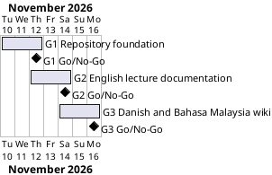

# Project Plan

## Metadata
| Key | Value |
| --- | --- |
| ID | PP-001 |
| CrossReference | [BC-001], [SA-001], [MIL-001], [MIL-002], [MIL-003] |
| Language | en |
| Domain | it |

## Version History
| Date | Status | Author | Reviewer | Change | Commit |
| --- | --- | --- | --- | --- | --- |
| 2026-11-10 | Deprecated | Jens Tirsvad Nielsen | AI as stand-in for S01 | Initial version | pending |
| 2026-11-10 | Accepted | Jens Tirsvad Nielsen | AI as stand-in for S01 | Accepted on a Go review, RC-003; autonomous, not independent | pending |

---

## Purpose

This plan schedules three gateways that deliver the Day 67 README and trilingual wiki inside the one-week constraint of [BC-001], from 2026-11-10 to 2026-11-17.

## Planning Assumptions

- The project starts 2026-11-10 and ends by 2026-11-17, per the Business Case constraint.
- Each gateway is one branch and one pull request. Gateway length is two to three days.
- S01 owns and approves every gateway, as in [SA-001]; the AI acts as stand-in in autonomous mode.
- Screenshots are illustrations with example data, because no code is run (see Open Issues).

## Gateway Schedule

| Gateway | Document | Window | Decision date | Owner | Stories | Main deliverable | Milestone |
| --- | --- | --- | --- | --- | --- | --- | --- |
| G1 Repository foundation | [MIL-001] | 2026-11-10 to 2026-11-12 | 2026-11-12 | S01 | none (technical tasks) | Repository metadata, project configuration, README skeleton, scan | not yet synced |
| G2 English lecture documentation | [MIL-002] | 2026-11-12 to 2026-11-14 | 2026-11-14 | S01 | none (documentation tasks) | English wiki, README steps, screenshots | not yet synced |
| G3 Danish and Bahasa Malaysia wiki | [MIL-003] | 2026-11-14 to 2026-11-16 | 2026-11-16 | S01 | none (documentation tasks) | Danish and Bahasa Malaysia wiki, language links | not yet synced |



## Scope Coverage

| Business Case scope item | Gateway |
| --- | --- |
| Repository setup (description, topics, .gitignore, pyproject.toml, Doxyfile, folders) | G1 |
| README with lecture steps, screenshots, venv, run and test instructions | G1 (skeleton and instructions), G2 (steps and screenshots) |
| Wiki in English | G2 |
| Wiki in Danish and Bahasa Malaysia | G3 |
| A screenshot for each lecture step | G2 (README and English wiki), G3 (translated pages) |
| Opengrep scan and AI prompt log | G1, G2, G3 |

## Dependencies

```
G1 → G2 → G3
```

A No-Go at a gateway returns that gateway to S01 for rework; later gateways move by the same number of days. S01 alone decides to move the end date of 2026-11-17.

## Plan Risks

| Risk | Impact | Mitigation |
| --- | --- | --- |
| Real screenshots are not available (BC-001 risk 1) | G2 cannot reach Go | Illustrations are labelled as such; S01 confirms the approach at plan acceptance |
| A pending language criterion needs S01 | A gateway is Go-with-conditions only | S01 confirms the pending criteria at plan acceptance or at the gateway |
| Translations take longer than planned | G3 slips | G3 has a one-day buffer before 2026-11-17 |

## Open Issues

- Source of the screenshots for each lecture step: illustrations with example data drawn for this repository (S01 confirms at plan acceptance), or captures S01 supplies later.
- Code is out of scope; the Python coding rules (`constants.py`, pytest tests, Doxygen comments) apply when code is added.
- The `src/` and `tests/` folders hold only a README each.

---

[BC-001]: ./business-case.md
[SA-001]: ./stakeholder-analysis.md
[MIL-001]: ./milestones/mil-001-repository-foundation.md
[MIL-002]: ./milestones/mil-002-english-lecture-documentation.md
[MIL-003]: ./milestones/mil-003-danish-and-malay-wiki.md
